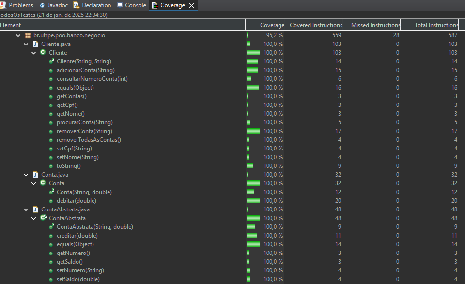
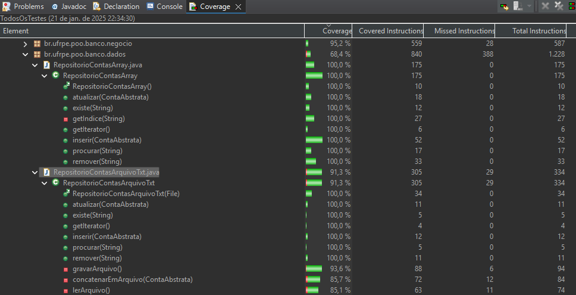
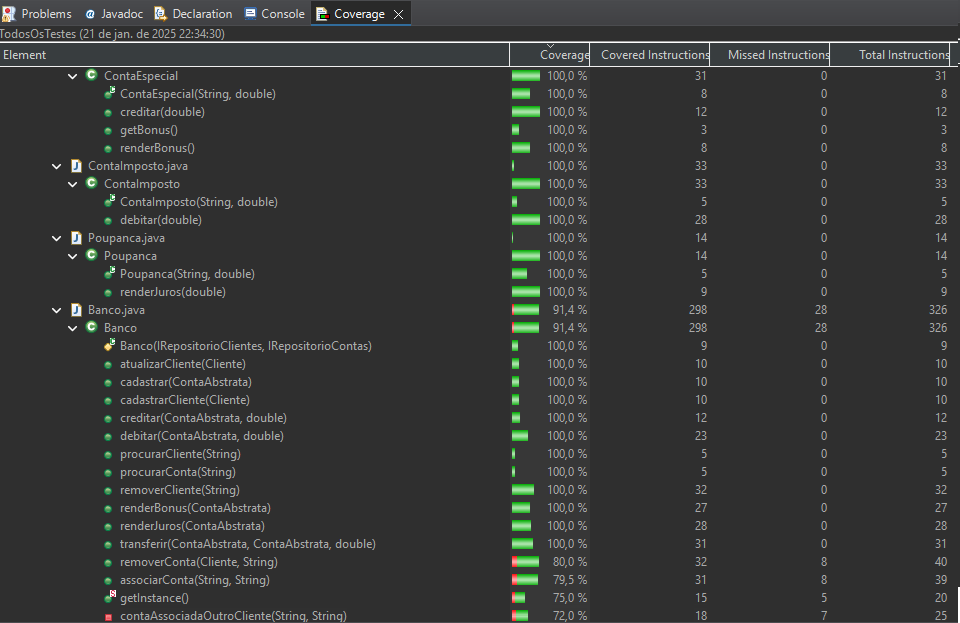

## Print atual da cobertura

Cliente - 100%

Conta - 100%

Conta Abstrata - 100%

RepositorioContasArray - 100%

RepositorioContasArquivoTxt - 91.3%

ContaEspecial - 100%

ContaImposto - 100%

Poupança - 100%

Banco - 91.4%

## Atividades

### Atv 1 - Criar Issues para tudo que não foi testado
-   Abrir issues para apontar partes do código que possuem algum problema ou que precisam de melhoria. No título da issue indicar [BUG] no título quando se tratar de um bug e [MELHORIA] quando se tratar de uma melhoria.

### Atv 2 - Criar testes para 90% das linhas e metodos das 9 Classes
-   Banco 
-   ContaAbstrata 
-   Conta 
-   Poupanca 
-   ContaEspecial 
-   ContaImposto 
-   Cliente
-   RepositórioContasArray
-   RepositórioContasArquivoTxt

### Atv 3 - Colocar no readme um print do relatorio do eclemma com a porcentagem de cobertura
-   Colocar no README.md uma imagem dos relatórios de cobertura gerados por Eclemma de forma que seja possível observar que a cobertura de cada uma das nove classes atingiu o percentual esperado

Projeto criado com o Eclipse RCP 2023-09 e Java-SE 18.